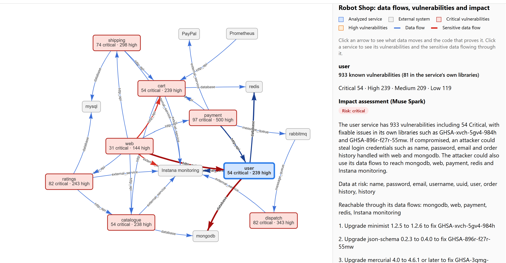

# FlowTrace

**FlowTrace finds where data flows between your services, which of those services are vulnerable, and what an attacker could reach through them.**

It reads source code across many repositories, uses **Meta's Muse Spark** to discover every data flow (with code evidence for each one), scans each service's container image for known vulnerabilities with Grype, and combines both into one interactive map plus an AI-written impact assessment for every service.

Built for the **Meta Global AI Developer Hackathon** (Oct 27 – Nov 4, 2026), *Build for Your World* theme, Indie Developer track.



---

## The problem

Security teams need to know two things together: **which services are vulnerable**, and **what sensitive data passes through them**. Vulnerability scanners only answer the first. Data flow diagrams, which answer the second, are drawn by hand, take days, and go out of date with the next commit.

So teams end up prioritizing by vulnerability count alone, which can be misleading. A service with many vulnerabilities but no sensitive data may matter less than one with fewer vulnerabilities that handles passwords.

I ran into this firsthand while building a data-dependency feature for a vulnerability-scanning application in my Master's capstone: mapping how systems depend on each other is slow, manual, and quickly out of date.

## What FlowTrace does

1. **Reads each service's code** — source, configs, Dockerfiles and schemas — skipping secrets like `.env` files.
2. **Discovers data flows with Muse Spark.** For every exchange between systems, it records the direction, what data is sent and returned, the data category (personal, payment, credentials, business, operational), and **the exact files and line numbers that prove it**.
3. **Verifies every answer.** FlowTrace checks that each cited file and line range really exists, then replaces the model's snippet with the real code. Flows with invented evidence are rejected.
4. **Merges all services into one map,** recognizing that `PAYMENTS_URL`, `http://payments-service:8000/charge` and `payments-service` are the same system.
5. **Scans each service's container image with Grype** and summarizes the results: unique vulnerabilities by severity, which are in the service's own libraries, and the most serious ones with their fixed versions.
6. **Writes an impact assessment per service with Muse Spark:** a risk level, the data at risk, which systems are reachable through its flows, and concrete fixes. FlowTrace verifies that every system and vulnerability ID it mentions comes from the real facts.
7. **Draws an interactive map:** red boxes for vulnerable services, thick red arrows for sensitive data flows, and click-through panels with evidence, vulnerabilities and impact.

## The key result: risk depends on data, not just vulnerability counts

On [Stan's Robot Shop](https://github.com/instana/robot-shop) (8 microservices in Node.js, Java, Python, Go and PHP):

| Service | Critical vulnerabilities | Sensitive data passing through it | FlowTrace risk |
|---|---|---|---|
| user | 54 | Passwords and emails (stored in plain text in MongoDB) | **critical** |
| cart | 54 | Usernames | **critical** |
| catalogue | 54 | None (product data only) | medium |
| dispatch | 82 | None (order IDs only) | **low** |

A plain scanner would rank **dispatch** above **cart** because it has more critical vulnerabilities. FlowTrace ranks it lowest, because no sensitive data passes through it and it only reaches the message queue and monitoring.

Other findings surfaced automatically:
- The **user** service stores passwords **in plain text** in MongoDB.
- The website sends each logged-in user's **name and email to a third-party monitoring service** (Instana).

## How Meta's models are used

- **Muse Spark (`muse-spark-1.3`) via the Meta Model API** performs both AI tasks: multi-language code analysis to extract structured data flows with evidence, and per-service impact reasoning over combined vulnerability and data-flow facts.
- Both tasks use **JSON mode** with strict schemas, and **every model output is verified** against ground truth (real files and line numbers; real scan results) before it reaches the map.
- A **model provider layer** (`flowtrace/providers/`) talks to any OpenAI-compatible endpoint, so the same code can run on Meta's open-weight models through partner inference, or on other providers, by changing `config.yaml`.

## Accuracy check

I compared FlowTrace's Robot Shop results by hand against the source code at the same commit. FlowTrace found **every service-to-service, database and message-queue connection** I could identify (cart→catalogue and redis, catalogue→mongodb, payment→user, cart, PayPal and RabbitMQ, RabbitMQ→dispatch, ratings→catalogue and mysql, shipping→cart and mysql, user→mongodb and redis, web→all six backend services), with **0 rejected flows** across all eight services. The prompt was refined over several runs to fix issues found in review: inconsistent arrow direction, replies reported as separate flows, build-time downloads counted as flows, and data categories guessed from service names.

## How to run it

**Requirements:** Python 3.10+, [Grype](https://github.com/anchore/grype) on your PATH, and a Meta Model API key.

```bash
git clone https://github.com/tejasai1/Flowtrace.git
cd Flowtrace
python -m venv .venv
.venv\Scripts\activate          # Windows  (macOS/Linux: source .venv/bin/activate)
pip install -r requirements.txt
```

Create a `.env` file with your key (it is ignored by Git):

```
MODEL_API_KEY=your-key-here
```

Download the demo application next to your home folder:

```bash
git clone https://github.com/instana/robot-shop.git ~/flowtrace-demos/robot-shop
cd ~/flowtrace-demos/robot-shop && git checkout 55292e2199f2fb00a165b1f7d3045fe7f8922038
```

Then, from the FlowTrace folder, run the three stages:

```bash
python -m scripts.smoke_test        # check the Muse Spark connection
python -m scripts.robot_shop_run    # 1. extract and verify data flows (8 Muse Spark calls)
python -m scripts.add_vulns         # 2. scan the 8 service images with Grype (slow the first time)
python -m scripts.impact_run        # 3. impact assessment per service (8 Muse Spark calls)
```

Open `output/robot_shop_impact/diagram.html` in a browser. Results are also saved as JSON (`flows.json`, `graph.json`, `report.json`) for use by other tools.

Offline tests that need no API key: `python -m scripts.model_test`, `scripts.extractor_test`, `scripts.graph_test`, `scripts.pipeline_test`.

## Project structure

| File | Purpose |
|---|---|
| `flowtrace/reader.py` | Collects code, config and schema files; skips secrets and generated folders |
| `flowtrace/extractor.py` | Muse Spark instructions for flow extraction; evidence verification |
| `flowtrace/models.py` | The data-flow format and its validation rules |
| `flowtrace/graph.py` | Merges flows across services, matches system names, removes clutter |
| `flowtrace/vulns.py` | Runs Grype, caches results, summarizes vulnerabilities |
| `flowtrace/impact.py` | Muse Spark impact assessment with fact verification |
| `flowtrace/diagram.py` | The interactive map |
| `flowtrace/pipeline.py` | Runs extraction and mapping for a folder of repositories |
| `flowtrace/providers/` | Model provider layer (OpenAI-compatible, plus an offline fake for tests) |

## Built during the hackathon

All code in this repository was written during the event (Oct 27 – Nov 4, 2026); the commit history shows each step. FlowTrace is a new, standalone project. It is inspired by my capstone work on data dependencies, but contains none of that project's code.

## Known limitations

- **One service at a time.** Muse Spark analyzes each service separately, so it can't know what another service puts in a shared field. For example, Robot Shop's user ID is actually a username, which the web code reveals but the payment code does not, so the same value is labeled personal in one flow and business in another.
- **"App library" labeling is approximate.** Language packages that come with the base image (such as `mercurial` in the Node.js images) are counted as the service's own libraries. Checking each package's install location would fix this.
- **Risk levels are judged by the model,** so similar cases can be rated slightly differently (for example, payment is rated critical mainly for its vulnerability count). A fixed scoring rule, with the model only explaining it, would make rankings fully consistent.
- **Vulnerability scanning uses published images.** Robot Shop's source doesn't pin dependency versions, so FlowTrace scans the built images instead, which reflects what actually runs.

## Future work

- Score risk with a fixed rule and let Muse Spark explain it
- Resolve shared identifiers across services in a second pass
- Run fully on Meta's open-weight models (Muse Spark Open) for code that can't leave the company
- Integrate with my capstone's vulnerability-scanning platform as an automatic data-dependency source

## Credits

- Demo application: [Stan's Robot Shop](https://github.com/instana/robot-shop) by Instana, Apache License 2.0, commit `55292e2`. Analyzed only; none of its code is included here.
- Vulnerability scanning: [Grype](https://github.com/anchore/grype) by Anchore.
- Map drawing: [vis-network](https://visjs.org/).

## License

MIT